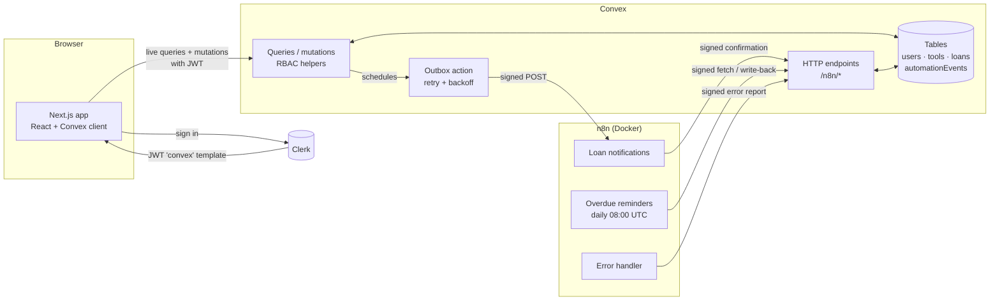

# LendLoop

> Borrow what you need. Lend what you don't.

LendLoop is a neighborhood tool-lending board. Neighbors list tools they're willing to lend,
request to borrow each other's tools for a date range, and the owner approves, declines and
marks them returned. n8n handles the automation: a notification on every request and status
change, and a daily reminder for overdue loans. Every run is written back to the app, so
each loan shows activity such as _"Approval notification sent 1 hour ago"_.

**Stack:** Next.js 16 (App Router, TypeScript strict) · Clerk · Convex · n8n (self-hosted,
Docker) · Tailwind CSS 4 · Vitest + convex-test

---

## Contents

1. [Architecture](#architecture)
2. [Local setup](#local-setup)
3. [Environment variables](#environment-variables)
4. [Test accounts and making an admin](#test-accounts-and-making-an-admin)
5. [Security decisions](#security-decisions)
6. [Data minimization](#data-minimization)
7. [Reliability](#reliability)
8. [Testing](#testing)
9. [Project structure](#project-structure)
10. [Design notes and trade-offs](#design-notes-and-trade-offs)

Production hardening is in [PRODUCTION.md](./PRODUCTION.md).

---

## Architecture



### Workflow 1: request notifications (Convex → n8n → Convex)

```
borrower requests / lender approves|declines|returns
  └─ Convex mutation (one transaction):
       • updates the loan
       • inserts automationEvents row { status: "pending", idempotencyKey: notification:<loanId>:<event> }
       • schedules internal action automation.deliverNotification
  └─ action: builds minimal payload, signs it (CONVEX_TO_N8N_SECRET), POSTs the n8n webhook
       • non-2xx / timeout → retry in 1s, 4s, 16s, 64s → after 5 attempts: status "failed" + error event
  └─ n8n: verify HMAC + timestamp → 401 if invalid
          → compose message → send (mock: logged) → signed POST /n8n/notifications → 200
  └─ Convex marks the event "sent"; the loan card shows "Approval notification sent just now"
```

### Workflow 2: overdue reminders (n8n → Convex)

```
n8n Schedule Trigger (daily 08:00 UTC)
  └─ signed POST /n8n/overdue-loans
       → approved loans with endDate < today, minus loans already reminded today
       → [{ loanId, idempotencyKey: reminder:<loanId>:<today>, borrowerName, borrowerEmail, toolName, endDate, daysOverdue }]
  └─ one item per loan → send reminder (mock: logged)
  └─ signed POST /n8n/reminders { loanId, idempotencyKey, status, message }
       → inserts only if the key is new; a retry returns 200 { duplicate: true }
```

### Error workflow

Both workflows have **LendLoop - Error handler** set as their n8n _Error Workflow_. When a
run fails after its node-level retries, the handler logs the failure, then sends a signed
POST to `/n8n/automation-errors`. That creates an `error` automation event, one per
execution (idempotent on the execution id).

---

## Local setup

**Requirements:** Node.js ≥ 20.9 (developed on 24), npm, Docker Desktop, a Clerk account and
a Convex account (both have free tiers).

### 1. Install

```bash
git clone <repo-url> lendloop && cd lendloop
npm install
```

### 2. Clerk

1. Create an application at [dashboard.clerk.com](https://dashboard.clerk.com) with **Email**
   sign-in.
2. **Configure → JWT templates → New template → Convex.** Keep the name **`convex`**. Check
   that the claims include `email`, `name` and `email_verified` (the Convex preset includes
   them), then save.
3. Copy the template's **Issuer** URL (e.g. `https://your-app.clerk.accounts.dev`).
4. From **API keys**, copy the publishable and secret keys.

Create `.env.local` in the project root:

```bash
NEXT_PUBLIC_CLERK_PUBLISHABLE_KEY=pk_test_...
CLERK_SECRET_KEY=sk_test_...
```

### 3. Convex

```bash
npx convex dev
```

This logs you in, creates a project, writes `CONVEX_DEPLOYMENT` and `NEXT_PUBLIC_CONVEX_URL`
to `.env.local`, and keeps pushing functions as you edit. The first push fails until the
issuer is set. In a second terminal:

```bash
npx convex env set CLERK_JWT_ISSUER_DOMAIN https://your-app.clerk.accounts.dev
npx convex env set ADMIN_EMAILS you@example.com

# HMAC secrets (one per direction). Generate two different values:
node -e "console.log(require('crypto').randomBytes(32).toString('hex'))"
npx convex env set CONVEX_TO_N8N_SECRET <secret-1>
npx convex env set N8N_TO_CONVEX_SECRET <secret-2>
```

`N8N_WEBHOOK_URL` is set in step 5, once n8n is running.

### 4. Run the app

```bash
npm run dev   # http://localhost:3000
```

Sign in. Your user row is created on first load, and if your email is in `ADMIN_EMAILS` you
get the **Admin** tab. You can list, borrow, approve and return now. Notifications show
_"notification failed"_ until n8n is connected, which is intentional: nothing fails silently.

### 5. n8n

```bash
cp n8n/.env.example n8n/.env
```

Fill in `n8n/.env`:

| Variable               | Value                                                                                     |
| ---------------------- | ----------------------------------------------------------------------------------------- |
| `CONVEX_SITE_URL`      | Your deployment's **`.convex.site`** URL (Convex dashboard → Settings → URL & deploy key) |
| `CONVEX_TO_N8N_SECRET` | Same value as the Convex env var                                                          |
| `N8N_TO_CONVEX_SECRET` | Same value as the Convex env var                                                          |
| `N8N_ENCRYPTION_KEY`   | Any long random string; keep it stable                                                    |

Then:

```bash
docker compose up -d
docker compose exec n8n n8n import:workflow --separate --input=/workflows
```

Open <http://localhost:5678>, create the owner account, then:

1. Open **LendLoop - Loan notifications** and **LendLoop - Overdue reminders**. In each one's
   **Settings**, check that **Error workflow** is **LendLoop - Error handler** (the exports
   reference it by id; re-select it if your n8n assigned new ids).
2. **Activate** all three workflows. The Error Trigger only fires for active workflows.
3. **No n8n credentials need to be created.** The workflows read the URL and secrets from
   the container environment (`$env`), so the exported JSON contains no secrets.

**Point Convex at the webhook.** Convex Cloud can't reach `localhost`, so expose n8n with the
bundled tunnel:

```bash
docker compose --profile tunnel up -d
docker compose logs tunnel | grep trycloudflare.com
npx convex env set N8N_WEBHOOK_URL https://<random>.trycloudflare.com/webhook/lendloop-loan-events
```

<details>
<summary>Fully local alternative (no tunnel)</summary>

Run Convex locally with `npx convex dev --local`. Then Convex can call n8n directly:
`N8N_WEBHOOK_URL=http://localhost:5678/webhook/lendloop-loan-events`. n8n reaches Convex via
`CONVEX_SITE_URL=http://host.docker.internal:3211`.

</details>

### 6. Try it end to end

1. As user A, list a tool. As user B (a second browser or private window), request it.
2. Watch the n8n execution. The log shows `[LendLoop mock notification] to=a***@…`, and B's
   request card under **Incoming** (signed in as A) shows _"Request notification sent just
   now"_.
3. Approve it, then check B's **My requests**.
4. To test reminders without waiting a day, make a loan overdue in the Convex dashboard (edit
   an approved loan's `endDate` to a past date), then click **Execute workflow** on
   _Overdue reminders_. Run it twice: the second run finds nothing, because Convex skips loans
   already reminded today.
5. To test failure handling, stop n8n (`docker compose stop n8n`) and approve a request. The
   card shows _"retrying"_ and then _"failed after 5 attempts"_, and an error event is
   recorded.

You can also call the Convex endpoints directly with a signed request:

```bash
CONVEX_SITE_URL=https://xxx.convex.site N8N_TO_CONVEX_SECRET=<secret-2> \
  node scripts/signed-request.mjs /n8n/overdue-loans '{}'
# add --bad-signature to see the 401
```

---

## Environment variables

| Name                                | Where it's set                | Used by                                   | Example placeholder                      |
| ----------------------------------- | ----------------------------- | ----------------------------------------- | ---------------------------------------- |
| `NEXT_PUBLIC_CLERK_PUBLISHABLE_KEY` | `.env.local`                  | Next.js (Clerk UI)                        | `pk_test_xxx`                            |
| `CLERK_SECRET_KEY`                  | `.env.local`                  | Next.js server (`proxy.ts`)               | `sk_test_xxx`                            |
| `CONVEX_DEPLOYMENT`                 | `.env.local` (written by CLI) | Convex CLI                                | `dev:happy-otter-123`                    |
| `NEXT_PUBLIC_CONVEX_URL`            | `.env.local` (written by CLI) | Next.js (Convex client)                   | `https://happy-otter-123.convex.cloud`   |
| `CLERK_JWT_ISSUER_DOMAIN`           | Convex env                    | `convex/auth.config.ts`                   | `https://your-app.clerk.accounts.dev`    |
| `ADMIN_EMAILS`                      | Convex env                    | `users.ensureCurrentUser` (first sign-in) | `you@example.com,ops@example.com`        |
| `N8N_WEBHOOK_URL`                   | Convex env                    | `automation.deliverNotification`          | `https://…/webhook/lendloop-loan-events` |
| `CONVEX_TO_N8N_SECRET`              | Convex env **and** `n8n/.env` | Convex signs, n8n verifies                | 64 hex chars                             |
| `N8N_TO_CONVEX_SECRET`              | Convex env **and** `n8n/.env` | n8n signs, Convex `http.ts` verifies      | 64 hex chars (different value)           |
| `CONVEX_SITE_URL`                   | `n8n/.env`                    | n8n HTTP Request nodes                    | `https://happy-otter-123.convex.site`    |
| `N8N_ENCRYPTION_KEY`                | `n8n/.env`                    | n8n credential encryption                 | long random string                       |

Templates: [`.env.example`](./.env.example) and [`n8n/.env.example`](./n8n/.env.example).
All `.env*` files are gitignored except those templates.

---

## Test accounts and making an admin

Clerk development instances accept **test emails**: any address containing `+clerk_test`
(e.g. `alice+clerk_test@example.com`) signs in with the verification code **`424242`**, so
no inbox is needed. Suggested accounts:

| Account                        | Role                                                  |
| ------------------------------ | ----------------------------------------------------- |
| `admin+clerk_test@example.com` | admin (put it in `ADMIN_EMAILS` before first sign-in) |
| `alice+clerk_test@example.com` | user: lists tools                                     |
| `bob+clerk_test@example.com`   | user: borrows                                         |

**How someone becomes admin.** There's deliberately no button, API or client argument for
it.

- **Bootstrap:** when a user row is first created, the role is `admin` only if the email is
  in the Convex env var `ADMIN_EMAILS` **and** Clerk reports it verified. Editing
  `ADMIN_EMAILS` later doesn't promote existing accounts.
- **Later changes:** `admin:setRole` is an _internal_ mutation, so only someone with deploy
  access can run it:

  ```bash
  npx convex run admin:setRole '{"email":"bob+clerk_test@example.com","role":"admin"}'
  ```

---

## Security decisions

**Authorization lives in Convex, not the UI.** Every public query and mutation starts with
a helper from [`convex/lib/auth.ts`](./convex/lib/auth.ts):

| Helper                                     | Guarantees                                                                                    |
| ------------------------------------------ | --------------------------------------------------------------------------------------------- |
| `requireUser(ctx)`                         | Valid Clerk JWT (signature checked by Convex), then loads the `users` row by `subject`        |
| `requireAdmin(ctx)`                        | `requireUser` + `role === "admin"` from the **database row**                                  |
| `assertToolOwner(user, tool)`              | Only the owner edits or deletes a listing                                                     |
| `assertLoanParticipant(user, loan, side?)` | Only the lender approves, declines or returns; borrowers and lenders see only their own loans |

The role is never read from the client or the JWT. Hiding the Admin tab and `proxy.ts`
redirects are UX only, and the tests call functions directly to prove the server rejects
what the UI would hide.

**Rules enforced server-side:** you can't borrow your own tool; start ≤ end; start isn't in
the past; at most 30 days; no overlap with an approved loan (checked at request **and** at
approval, to avoid race conditions); only valid status transitions
(`requested → approved | declined`, `approved → returned`); and you can't delete a tool that
is lent out.

**Input validation.** All arguments use Convex validators (`v.*`), and categories and
conditions are fixed enums. Text is trimmed, stripped of control characters and
length-limited (name 2–60, description ≤ 280) on the server. The client checks the same rules
only for quick feedback. React escapes all output.

**No PII on the public page.** `tools.listPublic` needs no auth and returns only
`{ _id, name, category }`. Its `returns` validator makes that a hard contract: if someone adds
an owner field, Convex rejects the response instead of leaking it (a test covers this).
Signed-in lists show the owner's display name, never an email. Admins are the only users who
see emails.

**Signed integration in both directions.** HMAC-SHA256 over `"<timestamp>.<raw body>"`, sent
as `X-LendLoop-Timestamp` and `X-LendLoop-Signature: sha256=<hex>`.

- The timestamp is inside the signed string, so it can't be changed. Requests more than
  5 minutes old are rejected, which limits replays. Replays inside the window are harmless
  because every write is idempotent.
- Convex verifies with `crypto.subtle.verify`, which is constant-time. n8n uses a
  constant-time comparison loop.
- There's **one secret per direction**, so a leak on one side doesn't let an attacker forge
  the other direction.
- Endpoints reject unsigned or invalid requests with `401` (the reason is only logged), cap
  bodies at 64 KB, and return `500` if the secret isn't configured instead of accepting
  anything.
- Tests run the exported n8n Code nodes against the Convex verifier, so the two sides can't
  drift apart.

**Secrets.** Secrets live only in Convex env vars, `.env.local` and `n8n/.env` (all
gitignored), with placeholder templates in the repo. The workflow JSON only contains
`{{ $env.NAME }}` references, and a test fails if a secret-like value appears in it.

_Trade-off:_ the workflows read secrets via `$env`, which requires
`N8N_BLOCK_ENV_ACCESS_IN_NODE=false`. That lets anyone who can edit workflows on this
n8n read its environment. For a single-owner instance this is acceptable. In production, use
n8n external secrets or a vault (see PRODUCTION.md).

---

## Data minimization

| Flow                                     | Fields sent                                                                           | Not sent, and why                                                                                                              |
| ---------------------------------------- | ------------------------------------------------------------------------------------- | ------------------------------------------------------------------------------------------------------------------------------ |
| Convex → n8n (notification)              | `eventId, event, loanId, recipient {name, email}, toolName, startDate, endDate`       | No user ids, roles, Clerk tokens or full user objects. Only the **recipient's** contact details, never the other party's email |
| n8n → Convex (notification confirmation) | `eventId, message`                                                                    | No email address goes back; Convex already knows the recipient                                                                 |
| Convex → n8n (overdue list)              | `loanId, idempotencyKey, borrowerName, borrowerEmail, toolName, endDate, daysOverdue` | No lender details or other loans. Loans already reminded today are excluded                                                    |
| n8n → Convex (reminder write-back)       | `loanId, idempotencyKey, status, message`                                             |                                                                                                                                |
| n8n → Convex (error report)              | `workflowName, executionId, nodeName, message` (truncated)                            | No item data or payloads                                                                                                       |
| n8n logs (mock delivery)                 | Masked email (`b***@example.com`), message text                                       | Full addresses never reach logs                                                                                                |

Tests assert the exact key sets of these payloads.

---

## Reliability

- **Transactional outbox.** The notification row is inserted, and the delivery action
  scheduled, in the **same transaction** as the loan change. If the mutation fails, neither
  happens. If it succeeds, delivery is guaranteed to be attempted.
- **Retries with backoff (Convex → n8n).** Each attempt has a 10 s timeout. Attempts run at
  1 s, 4 s, 16 s and 64 s (5 in total). After the last one, the event becomes `failed` with
  `lastError`, a separate `error` event is recorded, and `console.error` reaches the Convex
  logs. Missing configuration fails immediately instead of retrying.
- **Retries in n8n.** Every HTTP Request node has `retryOnFail` (3 tries, 2 s apart) and a
  10 s timeout.
- **Idempotency keys** (unique check on an index before every insert):
  - `notification:<loanId>:<event>`: each status event happens at most once per loan
  - `reminder:<loanId>:<YYYY-MM-DD>`: issued by Convex, so n8n retries and re-runs don't
    duplicate. The key must belong to the loan in the request.
  - `error:n8n:<workflow>:<executionId>` and `error:delivery:<eventId>`
- **Error workflow.** Records any failed n8n run in Convex, and logs first in case Convex is
  the thing that's down.
- **Status codes.** `4xx` means "fix the request, don't retry"; `5xx` means "safe to retry".
  A duplicate write returns `200`, so retries stop.
- **Visible in the UI.** Each loan card lists its automation events: sent, retrying, failed
  and reminders.

**Delivery semantics.** Notifications are _at least once_. If n8n sends the message but its
response to Convex is lost, Convex retries and the mock is logged twice. With a real email
provider, pass `eventId` as the provider's idempotency key (noted in the workflow).

---

## Testing

```bash
npm test          # Vitest: 65 tests
npm run lint      # ESLint (next + typescript + prettier-compat)
npm run typecheck # tsc --noEmit
npm run build     # production build
```

| File                                                               | Covers                                                                                                                             |
| ------------------------------------------------------------------ | ---------------------------------------------------------------------------------------------------------------------------------- |
| [`convex/lib/loanStatus.test.ts`](./convex/lib/loanStatus.test.ts) | Transition table, overdue derivation, date validation, inclusive overlap                                                           |
| [`convex/lib/hmac.test.ts`](./convex/lib/hmac.test.ts)             | Reference vector (OpenSSL), tampering, wrong secret, stale or moved timestamp, malformed input                                     |
| [`convex/rbac.test.ts`](./convex/rbac.test.ts)                     | Ownership, borrower vs lender actions, admin-only functions, admin bootstrap, no PII in public data                                |
| [`convex/automation.test.ts`](./convex/automation.test.ts)         | Signed minimal payload, retries leading to failure records, signed endpoints (401s, idempotent write-backs)                        |
| [`n8n/workflows.test.ts`](./n8n/workflows.test.ts)                 | Runs exported Code nodes against the Convex verifier in both directions; no secrets in JSON; retries and error workflow configured |

The Convex tests use [`convex-test`](https://docs.convex.dev/testing/convex-test), which runs
the real functions against an in-memory backend, with Clerk identities simulated.

---

## Project structure

```
app/                    Pages (App Router): /, /tools, /listings, /requests, /incoming, /admin
components/             UI: providers, badges, ToolForm, RequestLoanDialog, LoanCard, ActivityList, ui/*
convex/
  schema.ts             Tables + indexes
  auth.config.ts        Trusts Clerk JWTs (audience "convex")
  users.ts              First-sign-in provisioning, `me`
  tools.ts  loans.ts    Public API, each function starts with an auth helper
  admin.ts              Admin functions + internal setRole
  automation.ts         Internal: outbox delivery, payload builders, write-backs
  http.ts               Signed endpoints for n8n
  lib/                  auth, hmac, loanStatus, dates, outbox, retry, validators, constants
lib/                    Client helpers (error messages, formatting, mutation runner)
n8n/workflows/          Exported workflow JSON (no secrets)
scripts/                signed-request.mjs for manual endpoint testing
proxy.ts                Clerk route protection (Next 16's "middleware")
docker-compose.yml      n8n (+ optional cloudflared tunnel)
```

---

## Design notes and trade-offs

- **Dates are `YYYY-MM-DD` strings in UTC.** Loans are whole days, so there's no timezone
  math, and string comparison is correct for ranges and overdue checks. The UI shows dates in
  UTC and says so.
- **Overdue is derived, never stored.** It's computed from `status` and `endDate` when read,
  so it can't go stale. n8n's daily run does the side effects.
- **Soft delete for tools.** Loan history stays readable. Deleting declines pending requests
  (with notifications). Owners can't delete a tool that's on loan; admins can (moderation),
  and the lender can still mark it returned.
- **Approving auto-declines overlapping pending requests**, so lenders aren't left with
  requests they can't approve.
- **Only the lender marks a loan returned**, because they're the one who receives the tool.
- **Cache Components is off** (`next.config.ts`). All data comes from live Convex
  subscriptions on the client, so server caching would add nothing.
- **Signed endpoints are all POST**, so even "list overdue loans" has a body for the
  signature to cover.
- **n8n verification re-serializes the parsed JSON body.** Convex sends compact
  `JSON.stringify` output, which round-trips exactly. The n8n → Convex direction sends
  raw-string bodies, so the signed bytes are the sent bytes. Both are covered by tests.
- **Lists are capped (200)** rather than paginated. That's plenty for a neighborhood; see
  PRODUCTION.md.
