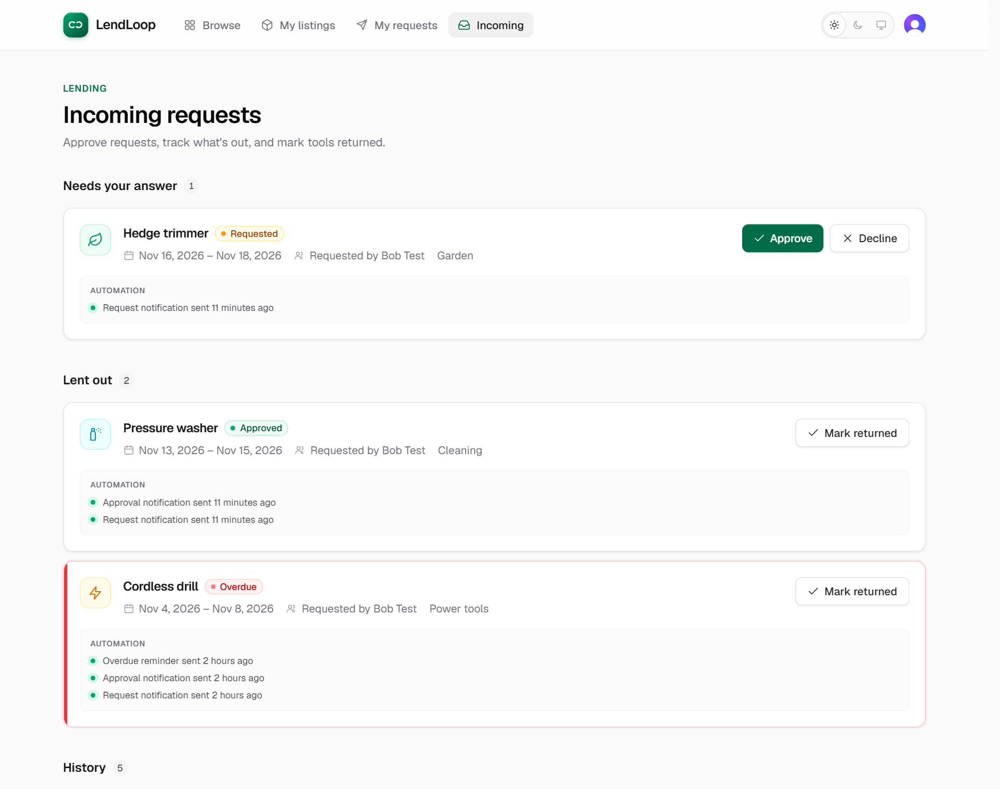
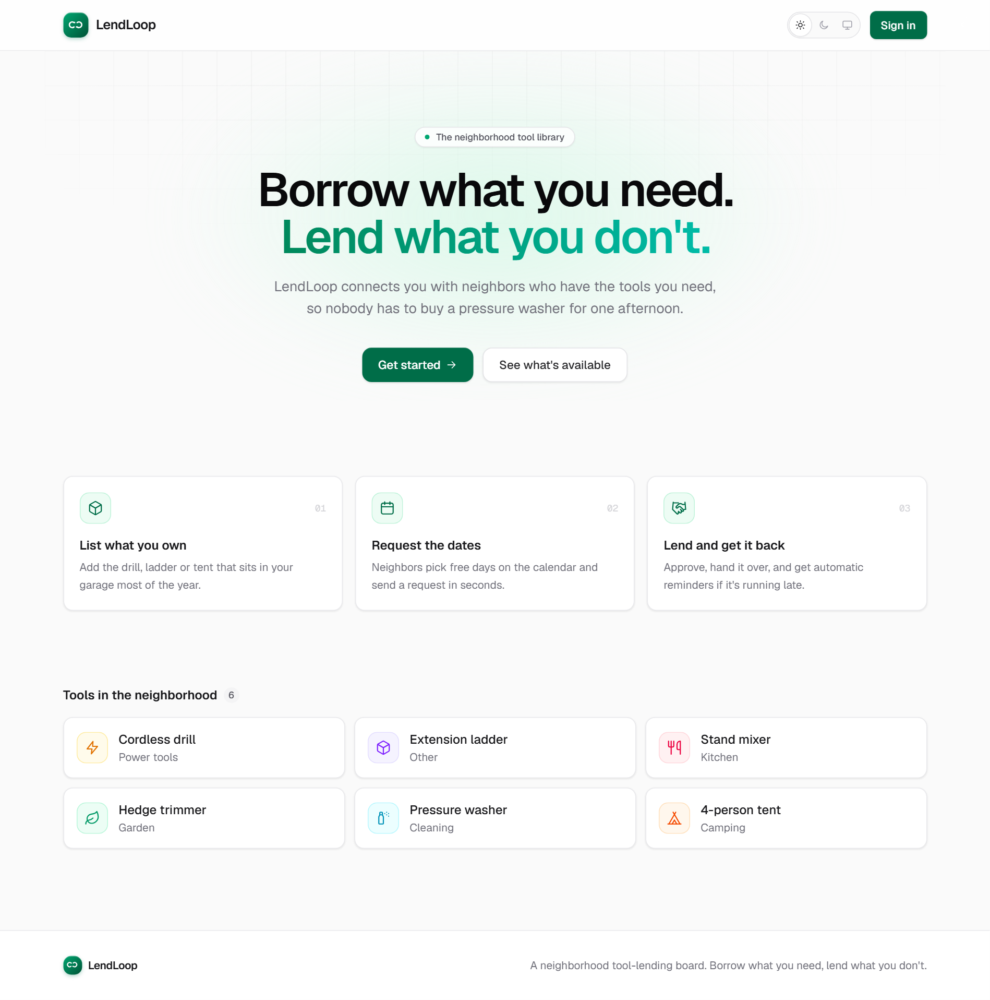
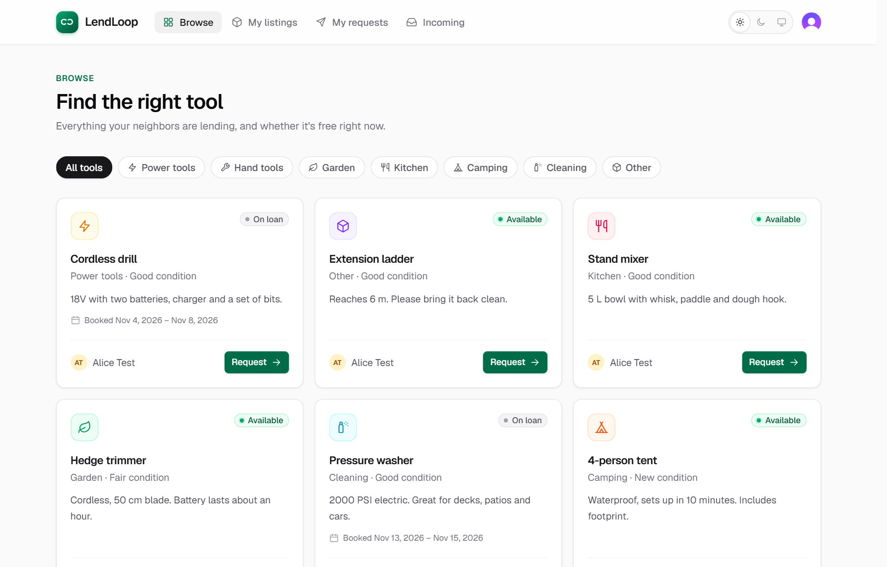
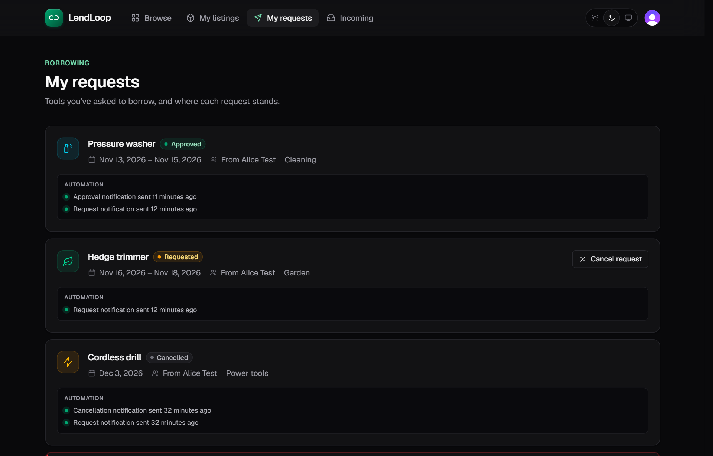
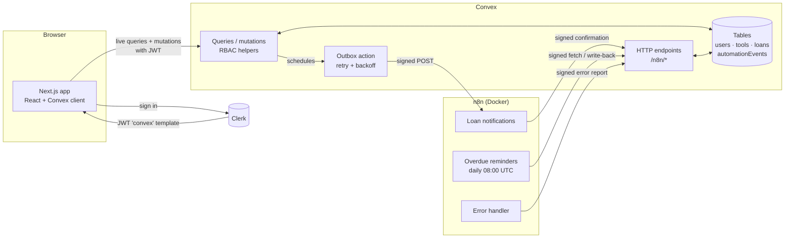

# LendLoop

> Borrow what you need. Lend what you don't.



| Public page (no sign-in)                                                                | Browse tools                                                                       | My requests, dark mode                                                                                 |
| --------------------------------------------------------------------------------------- | ---------------------------------------------------------------------------------- | ------------------------------------------------------------------------------------------------------ |
|  |  |  |

LendLoop is a neighborhood tool-lending board. Neighbors list tools they're willing to
lend, request to borrow each other's tools for a date range, and the owner approves,
declines and marks them returned. Borrowers can cancel a request while it's pending. n8n
handles the automation: a notification on every request and status change, and a daily
reminder for overdue loans. Every run is written back to the app, so each loan shows
activity such as _"Approval notification sent 1 hour ago"_.

The UI updates live across users (Convex subscriptions), works on phones, and has a
Light / Dark / System theme switch in the header.

**Stack:** Next.js 16 (App Router, TypeScript strict) · Clerk · Convex · n8n (self-hosted,
Docker) · Tailwind CSS 4 · Vitest + convex-test

## Quick start

```bash
git clone https://github.com/jeanclaudegeagea/lendloop.git && cd lendloop && npm install
cp .env.example .env.local        # add your Clerk keys (step 2 below)
npx convex dev                    # terminal 1, keep it running; then set the Convex env vars (step 3)
cp n8n/.env.example n8n/.env      # same secrets as Convex (step 5a)
docker compose up -d
docker compose exec n8n n8n import:workflow --separate --input=/workflows
# open http://localhost:5678, publish the 3 workflows, set N8N_WEBHOOK_URL (step 5c-d)
npm run dev                       # terminal 2, then open http://localhost:3000
```

First time? Follow [Local setup](#local-setup) for the details behind each line.

---

## Contents

1. [Architecture](#architecture)
2. [Local setup](#local-setup) (includes [Windows notes](#windows-notes) and
   [Troubleshooting](#troubleshooting))
3. [Environment variables](#environment-variables)
4. [Test accounts and making an admin](#test-accounts-and-making-an-admin)
5. [Security decisions](#security-decisions)
6. [Data minimization](#data-minimization)
7. [Reliability](#reliability)
8. [Testing](#testing)
9. [Project structure](#project-structure)
10. [Design notes and trade-offs](#design-notes-and-trade-offs)

Production hardening is in [PRODUCTION.md](./PRODUCTION.md).

---

## Architecture



### Workflow 1: request notifications (Convex → n8n → Convex)

```
borrower requests|cancels / lender approves|declines|returns
  └─ Convex mutation (one transaction):
       • updates the loan
       • inserts automationEvents row { status: "pending", idempotencyKey: notification:<loanId>:<event> }
       • schedules internal action automation.deliverNotification
  └─ action: builds minimal payload, signs it (CONVEX_TO_N8N_SECRET), POSTs the n8n webhook
       • non-2xx / timeout → retry in 1s, 4s, 16s, 64s → after 5 attempts: status "failed" + error event
  └─ n8n: verify HMAC + timestamp → 401 if invalid
          → compose message → send (mock: logged) → signed POST /n8n/notifications → 200
  └─ Convex marks the event "sent"; the loan card shows "Approval notification sent just now"
```

### Workflow 2: overdue reminders (n8n → Convex)

```
n8n Schedule Trigger (daily 08:00 UTC)
  └─ signed POST /n8n/overdue-loans
       → approved loans with endDate < today, minus loans already reminded today
       → [{ loanId, idempotencyKey: reminder:<loanId>:<today>, borrowerName, borrowerEmail, toolName, endDate, daysOverdue }]
  └─ one item per loan → send reminder (mock: logged)
  └─ signed POST /n8n/reminders { loanId, idempotencyKey, status, message }
       → inserts only if the key is new; a retry returns 200 { duplicate: true }
```

### Error workflow

Both workflows have **LendLoop - Error handler** set as their n8n _Error Workflow_. When a
run fails after its node-level retries, the handler logs the failure, then sends a signed
POST to `/n8n/automation-errors`. That creates an `error` automation event, one per
execution (idempotent on the execution id).

---

## Local setup

**Requirements:** Node.js ≥ 20.9 (developed on 24), npm,
[Docker Desktop](https://www.docker.com/products/docker-desktop/), and a free
[Clerk](https://clerk.com) account. A Convex account is optional (see step 3).

> **Windows:** read [Windows notes](#windows-notes) once before starting. Where a command
> differs between PowerShell and Git Bash / macOS / Linux, both versions are shown.

You'll end up with **three things running** at once (n8n runs in the background in Docker):

| Where      | Command          | What it is                                |
| ---------- | ---------------- | ----------------------------------------- |
| Terminal 1 | `npx convex dev` | Convex backend + pushes functions on save |
| Terminal 2 | `npm run dev`    | The app at <http://localhost:3000>        |
| Docker     | `docker compose` | n8n at <http://localhost:5678>            |

### 1. Install

```bash
git clone <repo-url> lendloop
cd lendloop
npm install
```

### 2. Clerk

1. Create an application at [dashboard.clerk.com](https://dashboard.clerk.com) with
   **Email** as the sign-in method. Leave phone and username off, so sign-up only asks for
   an email (and optionally a password).
2. **Configure → JWT templates → New template → Convex.** Keep the name exactly **`convex`**
   (lowercase). Keep the preset claims: they include `"aud": "convex"`, `email`, `name` and
   `email_verified`, which the app needs. Leave **Custom signing key** off. Save.
3. Copy the template's **Issuer** URL (e.g. `https://your-app-12.clerk.accounts.dev`).
4. From **Configure → API keys**, copy the **publishable** and **secret** keys.

Create `.env.local` in the project root with the two keys (or copy
[`.env.example`](./.env.example)):

```bash
NEXT_PUBLIC_CLERK_PUBLISHABLE_KEY=pk_test_...
CLERK_SECRET_KEY=sk_test_...
```

The Convex CLI adds its own lines to this file in the next step; leave them there.

### 3. Convex

In **terminal 1**:

```bash
npx convex dev
```

On first run the CLI asks how to set up the backend. Pick one:

- **Local (recommended, no account needed):** choose to run **locally without an
  account**. The backend runs on your machine at `http://127.0.0.1:3210`, with HTTP actions
  on port `3211`. This is the simplest setup with n8n because no tunnel is needed.
- **Convex Cloud:** log in and create a project. You'll need the tunnel in step 5d,
  because Convex Cloud can't reach `localhost`.

Either way the CLI writes `CONVEX_DEPLOYMENT` and `NEXT_PUBLIC_CONVEX_URL` to `.env.local`
and keeps running, pushing functions as you edit. **Leave it running:** both the app and
n8n need it. The first push may fail until the issuer below is set; that's expected.

In a **second terminal**, set the Convex environment variables:

```bash
npx convex env set CLERK_JWT_ISSUER_DOMAIN https://your-app-12.clerk.accounts.dev
npx convex env set ADMIN_EMAILS admin+clerk_test@example.com
```

`ADMIN_EMAILS` is the email (or comma-separated emails) that becomes admin on **first**
sign-in, so set it before that account signs up. See
[Test accounts](#test-accounts-and-making-an-admin).

Next, the two HMAC secrets, one per direction. Run the generator **twice** and use a
**different** value for each:

```bash
node -e "console.log(require('crypto').randomBytes(32).toString('hex'))"
npx convex env set CONVEX_TO_N8N_SECRET <first-value>
npx convex env set N8N_TO_CONVEX_SECRET <second-value>
```

Check that `npx convex env list` shows these four names. (`N8N_WEBHOOK_URL` is added in
step 5d.) Terminal 1 should now print **"Convex functions ready!"**; if it showed an auth
error earlier, save any file or restart it.

### 4. Run the app

In **terminal 2**:

```bash
npm run dev
```

Open <http://localhost:3000> and **sign up** (not sign in; see
[Test accounts](#test-accounts-and-making-an-admin)). Your user row is created on first
load, and if your email is in `ADMIN_EMAILS` you get the **Admin** tab. You can already list,
borrow, approve and return. Until n8n is connected, notifications show
_"notification failed"_. That's intentional: nothing fails silently.

### 5. n8n

**a. Create `n8n/.env`** from the template:

```bash
# PowerShell
Copy-Item n8n/.env.example n8n/.env
# Git Bash / macOS / Linux
cp n8n/.env.example n8n/.env
```

Fill it in. The two secrets must be **identical** to the Convex values from step 3. Print
them with `npx convex env get CONVEX_TO_N8N_SECRET` and
`npx convex env get N8N_TO_CONVEX_SECRET`.

| Variable               | Local Convex                       | Convex Cloud                                             |
| ---------------------- | ---------------------------------- | -------------------------------------------------------- |
| `CONVEX_SITE_URL`      | `http://host.docker.internal:3211` | Your **`.convex.site`** URL (dashboard → Settings → URL) |
| `CONVEX_TO_N8N_SECRET` | Same as the Convex env var         | Same as the Convex env var                               |
| `N8N_TO_CONVEX_SECRET` | Same as the Convex env var         | Same as the Convex env var                               |
| `N8N_ENCRYPTION_KEY`   | Any long random string; keep it    | Any long random string; keep it                          |

`CONVEX_SITE_URL` is the **`.convex.site`** (HTTP actions) URL, not `.convex.cloud`. For a
local backend that means port **3211**, not 3210.

**b. Start n8n and import the workflows.** Docker Desktop must be running (its whale icon
says _"Engine running"_). The Docker Desktop app can't start a compose file, so use the
terminal:

```bash
docker compose up -d
docker compose exec n8n n8n import:workflow --separate --input=/workflows
```

The first `up` downloads the n8n image, which is a few hundred MB. The container then
appears in Docker Desktop → **Containers** as `lendloop` → `n8n`. Wait until it shows
**Running**.

**c. Set up n8n** at <http://localhost:5678>:

1. Create the owner account. It's local only, so any email and password will do.
2. Open **LendLoop - Loan notifications** and **LendLoop - Overdue reminders**. In each one,
   open **⋯ → Settings** and check that **Error workflow** is **LendLoop - Error handler**.
   Re-select it if your n8n assigned new ids, then save.
3. **Publish** all three workflows with the **Publish** button at the top right of each.
   n8n 2.x replaced the old "Active" toggle with Publish, and the webhook URL only works
   once _Loan notifications_ is published.
4. **No n8n credentials need to be created.** The workflows read the URL and secrets from
   the container environment (`$env`), so the exported JSON contains no secrets.

**d. Point Convex at the webhook.**

With **local Convex**, Convex calls n8n directly:

```bash
npx convex env set N8N_WEBHOOK_URL http://localhost:5678/webhook/lendloop-loan-events
```

With **Convex Cloud**, expose n8n with the bundled Cloudflare tunnel, then use its URL:

```bash
docker compose --profile tunnel up -d
docker compose logs tunnel        # find the https://<random>.trycloudflare.com line
npx convex env set N8N_WEBHOOK_URL https://<random>.trycloudflare.com/webhook/lendloop-loan-events
```

The tunnel URL changes every time the tunnel restarts, so set it again when that happens.

**e. Check the wiring.** Each command should print what its comment shows. For Convex
Cloud, use your `.convex.site` URL instead of `http://127.0.0.1:3211`.

```bash
# PowerShell
$env:CONVEX_SITE_URL="http://127.0.0.1:3211"; $env:N8N_TO_CONVEX_SECRET="<second-value>"
node scripts/signed-request.mjs n8n/overdue-loans '{}'                   # 200 {"today":...}
node scripts/signed-request.mjs n8n/overdue-loans '{}' --bad-signature   # 401

# Git Bash / macOS / Linux
export CONVEX_SITE_URL=http://127.0.0.1:3211 N8N_TO_CONVEX_SECRET=<second-value>
node scripts/signed-request.mjs n8n/overdue-loans '{}'                   # 200 {"today":...}
node scripts/signed-request.mjs n8n/overdue-loans '{}' --bad-signature   # 401
```

```bash
curl -X POST http://localhost:5678/webhook/lendloop-loan-events -H "Content-Type: application/json" -d "{}"
# {"error":"Unauthorized"}  → the workflow is published and checks signatures
```

In Windows PowerShell 5, use `curl.exe` instead of `curl`.

### 6. Try it end to end

Use two test accounts with code **`424242`** (no inbox needed): Alice in a normal window and
Bob in a private/incognito window.

**Workflow 1: notifications**

1. As Alice, go to **My listings → List a tool**.
2. As Bob, go to **Browse**, click **Request**, pick dates, then **Send request**.
3. As Alice, open **Incoming**. Within a few seconds the card shows
   _"Request notification sent just now"_. In n8n, **Executions** shows the run, and the
   container logs (`docker compose logs n8n`, or Docker Desktop → Logs) show
   `[LendLoop mock notification] to=a***@…`.
4. Click **Approve**. Bob's **My requests** updates live and shows _"Approval notification
   sent"_. Then click **Mark returned** as Alice.

**Workflow 2: overdue reminders** (without waiting for the 08:00 UTC schedule)

1. Have Bob request a tool and Alice **approve** it. **Don't** mark it returned: only
   approved loans can be overdue.
2. Open the Convex dashboard with `npx convex dashboard`, go to the **loans** table, and
   change that loan's `endDate` to a past date (e.g. last week). The card turns red
   (**Overdue**) right away, because overdue is computed, not stored.
3. In n8n, open **LendLoop - Overdue reminders** and click **Execute workflow**.
   _Fetch overdue loans_ returns 1 loan, and the run ends at _Record reminder in Convex_. The
   card shows _"Overdue reminder sent just now"_.
4. Click **Execute workflow** again. It finds **0** loans, because Convex skips loans
   already reminded today (idempotency key `reminder:<loanId>:<date>`).

**Error workflow** (an n8n run fails → Error handler → Convex)

```bash
# PowerShell
$env:N8N_WEBHOOK_URL="http://localhost:5678/webhook/lendloop-loan-events"; $env:CONVEX_TO_N8N_SECRET="<first-value>"
node scripts/trigger-n8n-failure.mjs

# Git Bash / macOS / Linux
export N8N_WEBHOOK_URL=http://localhost:5678/webhook/lendloop-loan-events CONVEX_TO_N8N_SECRET=<first-value>
node scripts/trigger-n8n-failure.mjs
```

The script sends a correctly signed event whose event id doesn't exist. n8n logs three
`404 Unknown event` retries, the run fails (`500`), and the **Error handler** records it in
Convex. `npx convex data automationEvents --limit 1` then shows `type: "error"`,
`event: "workflow_failed"` and _"…failed at "Record in Convex""_. In n8n, **Executions**
shows both the failed run and the Error handler run.

**Convex retries** (n8n is down → Convex backs off, then records the failure)

Stop n8n with `docker compose stop n8n` and have Bob send a request. The card shows
_"retrying"_, then about 90 seconds later _"failed after 5 attempts"_, and an error event is
recorded. Start n8n again with `docker compose start n8n`.

### Windows notes

- **`docker` not found** right after installing Docker Desktop: open a **new** terminal so
  it picks up the updated `PATH`.
- **Setting environment variables for a command:** Git Bash accepts `VAR=value command`
  and `export VAR=value`. In PowerShell, set them first with `$env:VAR="value"`, then run
  the command.
- **Git Bash rewrites arguments that start with `/`** into Windows paths (so
  `/n8n/overdue-loans` becomes `C:/Program Files/Git/n8n/...`). That's why the examples
  pass `n8n/overdue-loans` without a leading slash. You can also prefix a command with
  `MSYS_NO_PATHCONV=1`.
- `cp` and `curl` behave differently in PowerShell. The examples above give PowerShell
  versions where it matters.

### Troubleshooting

| Symptom                                                      | Cause and fix                                                                                                                                                      |
| ------------------------------------------------------------ | ------------------------------------------------------------------------------------------------------------------------------------------------------------------ |
| Clerk says _"Couldn't find your account"_                    | The account doesn't exist yet. Click **Sign up** at the bottom of the Clerk dialog. Test emails still need to sign up once.                                        |
| Signed in, but pages show an auth error or keep loading      | `CLERK_JWT_ISSUER_DOMAIN` is missing or wrong, or the JWT template isn't named `convex`. Fix it, then check that terminal 1 prints _"Convex functions ready!"_.    |
| No **Admin** tab for the admin email                         | The account was created before `ADMIN_EMAILS` was set, or its email isn't verified. Promote it with `npx convex run admin:setRole '{"email":"…","role":"admin"}'`. |
| App loads but shows no data; n8n logs _"connection refused"_ | `npx convex dev` isn't running (for example after a reboot). Start it again in terminal 1.                                                                         |
| Cards say _"notification failed"_                            | `N8N_WEBHOOK_URL` isn't set, n8n isn't running, or _Loan notifications_ isn't published. Check with the `curl` command in step 5e.                                 |
| n8n returns `401` to real events                             | `CONVEX_TO_N8N_SECRET` in `n8n/.env` differs from Convex. Fix it, then run `docker compose up -d`, which recreates the container with the new values.              |
| Convex returns `401` to n8n                                  | The same problem with `N8N_TO_CONVEX_SECRET`.                                                                                                                      |
| The n8n webhook returns `404`                                | The workflow isn't published, or the URL is wrong. It must end in `/webhook/lendloop-loan-events` (not `/webhook-test/`).                                          |
| `docker compose up` hangs on the first download              | Restart Docker Desktop (whale icon → Restart) and run it again. This is common right after a fresh install.                                                        |
| The overdue run finds 0 loans                                | The loan must be **approved** (not requested or returned), its `endDate` must be before today in **UTC**, and it must not have been reminded already today.        |
| n8n logs `SSL … bad record mac` errors from `api.n8n.io`     | Harmless. This is n8n fetching its community-node catalog, which has nothing to do with LendLoop.                                                                  |

---

## Environment variables

| Name                                | Where it's set                | Used by                                   | Example placeholder                                                                 |
| ----------------------------------- | ----------------------------- | ----------------------------------------- | ----------------------------------------------------------------------------------- |
| `NEXT_PUBLIC_CLERK_PUBLISHABLE_KEY` | `.env.local`                  | Next.js (Clerk UI)                        | `pk_test_xxx`                                                                       |
| `CLERK_SECRET_KEY`                  | `.env.local`                  | Next.js server (`proxy.ts`)               | `sk_test_xxx`                                                                       |
| `CONVEX_DEPLOYMENT`                 | `.env.local` (written by CLI) | Convex CLI                                | `dev:happy-otter-123`                                                               |
| `NEXT_PUBLIC_CONVEX_URL`            | `.env.local` (written by CLI) | Next.js (Convex client)                   | `https://happy-otter-123.convex.cloud`                                              |
| `CLERK_JWT_ISSUER_DOMAIN`           | Convex env                    | `convex/auth.config.ts`                   | `https://your-app.clerk.accounts.dev`                                               |
| `ADMIN_EMAILS`                      | Convex env                    | `users.ensureCurrentUser` (first sign-in) | `you@example.com,ops@example.com`                                                   |
| `N8N_WEBHOOK_URL`                   | Convex env                    | `automation.deliverNotification`          | `http://localhost:5678/webhook/lendloop-loan-events` (local)                        |
| `CONVEX_TO_N8N_SECRET`              | Convex env **and** `n8n/.env` | Convex signs, n8n verifies                | 64 hex chars                                                                        |
| `N8N_TO_CONVEX_SECRET`              | Convex env **and** `n8n/.env` | n8n signs, Convex `http.ts` verifies      | 64 hex chars (different value)                                                      |
| `CONVEX_SITE_URL`                   | `n8n/.env`                    | n8n HTTP Request nodes                    | `https://happy-otter-123.convex.site` or `http://host.docker.internal:3211` (local) |
| `N8N_ENCRYPTION_KEY`                | `n8n/.env`                    | n8n credential encryption                 | long random string                                                                  |

Templates: [`.env.example`](./.env.example) and [`n8n/.env.example`](./n8n/.env.example).
All `.env*` files are gitignored except those templates.

---

## Test accounts and making an admin

Clerk development instances accept **test emails**: any address containing `+clerk_test`
(e.g. `alice+clerk_test@example.com`) signs in with the verification code **`424242`**, so
no inbox is needed. **Sign up** with each address the first time (Clerk's sign-in only
works for existing accounts and otherwise says _"Couldn't find your account"_); after that,
sign in with the same code. Suggested accounts:

| Account                        | Role                                                  |
| ------------------------------ | ----------------------------------------------------- |
| `admin+clerk_test@example.com` | admin (put it in `ADMIN_EMAILS` before first sign-in) |
| `alice+clerk_test@example.com` | user: lists tools                                     |
| `bob+clerk_test@example.com`   | user: borrows                                         |

**How someone becomes admin.** There's deliberately no button, API or client argument for
it.

- **Bootstrap:** when a user row is first created, the role is `admin` only if the email is
  in the Convex env var `ADMIN_EMAILS` **and** Clerk reports it verified. Editing
  `ADMIN_EMAILS` later doesn't promote existing accounts.
- **Later changes:** `admin:setRole` is an _internal_ mutation, so only someone with deploy
  access can run it:

  ```bash
  npx convex run admin:setRole '{"email":"bob+clerk_test@example.com","role":"admin"}'
  ```

---

## Security decisions

**Authorization lives in Convex, not the UI.** Every public query and mutation starts with
a helper from [`convex/lib/auth.ts`](./convex/lib/auth.ts):

| Helper                                     | Guarantees                                                                                                    |
| ------------------------------------------ | ------------------------------------------------------------------------------------------------------------- |
| `requireUser(ctx)`                         | Valid Clerk JWT (signature checked by Convex), then loads the `users` row by `subject`                        |
| `requireAdmin(ctx)`                        | `requireUser` + `role === "admin"` from the **database row**                                                  |
| `assertToolOwner(user, tool)`              | Only the owner edits or deletes a listing                                                                     |
| `assertLoanParticipant(user, loan, side?)` | Only the lender approves, declines or returns; only the borrower cancels; each side sees only their own loans |

The role is never read from the client or the JWT. Hiding the Admin tab and `proxy.ts`
redirects are UX only, and the tests call functions directly to prove the server rejects
what the UI would hide.

**Rules enforced server-side:** you can't borrow your own tool; start ≤ end; start isn't in
the past; at most 30 days; no overlap with an approved loan (checked at request **and** at
approval, to avoid race conditions); only valid status transitions
(`requested → approved | declined | cancelled`, `approved → returned`); only the borrower
can cancel, and only while the request is pending; and you can't delete a tool that
is lent out.

**Input validation.** All arguments use Convex validators (`v.*`), and categories and
conditions are fixed enums. Text is trimmed, stripped of control characters and
length-limited (name 2–60, description ≤ 280) on the server. The client checks the same rules
only for quick feedback. React escapes all output.

**No PII on the public page.** `tools.listPublic` needs no auth and returns only
`{ _id, name, category }`. Its `returns` validator makes that a hard contract: if someone adds
an owner field, Convex rejects the response instead of leaking it (a test covers this).
Signed-in lists show the owner's display name, never an email. Admins are the only users who
see emails.

**Signed integration in both directions.** HMAC-SHA256 over `"<timestamp>.<raw body>"`, sent
as `X-LendLoop-Timestamp` and `X-LendLoop-Signature: sha256=<hex>`.

- The timestamp is inside the signed string, so it can't be changed. Requests more than
  5 minutes old are rejected, which limits replays. Replays inside the window are harmless
  because every write is idempotent.
- Convex verifies with `crypto.subtle.verify`, which is constant-time. n8n uses a
  constant-time comparison loop.
- There's **one secret per direction**, so a leak on one side doesn't let an attacker forge
  the other direction.
- Endpoints reject unsigned or invalid requests with `401` (the reason is only logged), cap
  bodies at 64 KB, and return `500` if the secret isn't configured instead of accepting
  anything.
- Tests run the exported n8n Code nodes against the Convex verifier, so the two sides can't
  drift apart.

**Secrets.** Secrets live only in Convex env vars, `.env.local` and `n8n/.env` (all
gitignored), with placeholder templates in the repo. The workflow JSON only contains
`{{ $env.NAME }}` references, and a test fails if a secret-like value appears in it.

_Trade-off:_ the workflows read secrets via `$env`, which requires
`N8N_BLOCK_ENV_ACCESS_IN_NODE=false`. That lets anyone who can edit workflows on this
n8n read its environment. For a single-owner instance this is acceptable. In production, use
n8n external secrets or a vault (see PRODUCTION.md).

---

## Data minimization

| Flow                                     | Fields sent                                                                           | Not sent, and why                                                                                                              |
| ---------------------------------------- | ------------------------------------------------------------------------------------- | ------------------------------------------------------------------------------------------------------------------------------ |
| Convex → n8n (notification)              | `eventId, event, loanId, recipient {name, email}, toolName, startDate, endDate`       | No user ids, roles, Clerk tokens or full user objects. Only the **recipient's** contact details, never the other party's email |
| n8n → Convex (notification confirmation) | `eventId, message`                                                                    | No email address goes back; Convex already knows the recipient                                                                 |
| Convex → n8n (overdue list)              | `loanId, idempotencyKey, borrowerName, borrowerEmail, toolName, endDate, daysOverdue` | No lender details or other loans. Loans already reminded today are excluded                                                    |
| n8n → Convex (reminder write-back)       | `loanId, idempotencyKey, status, message`                                             |                                                                                                                                |
| n8n → Convex (error report)              | `workflowName, executionId, nodeName, message` (truncated)                            | No item data or payloads                                                                                                       |
| n8n logs (mock delivery)                 | Masked email (`b***@example.com`), message text                                       | Full addresses never reach logs                                                                                                |

Tests assert the exact key sets of these payloads.

---

## Reliability

- **Transactional outbox.** The notification row is inserted, and the delivery action
  scheduled, in the **same transaction** as the loan change. If the mutation fails, neither
  happens. If it succeeds, delivery is guaranteed to be attempted.
- **Retries with backoff (Convex → n8n).** Each attempt has a 10 s timeout. Attempts run at
  1 s, 4 s, 16 s and 64 s (5 in total). After the last one, the event becomes `failed` with
  `lastError`, a separate `error` event is recorded, and `console.error` reaches the Convex
  logs. Missing configuration fails immediately instead of retrying.
- **Retries in n8n.** Every HTTP Request node has `retryOnFail` (3 tries, 2 s apart) and a
  10 s timeout.
- **Idempotency keys** (unique check on an index before every insert):
  - `notification:<loanId>:<event>`: each status event happens at most once per loan
  - `reminder:<loanId>:<YYYY-MM-DD>`: issued by Convex, so n8n retries and re-runs don't
    duplicate. The key must belong to the loan in the request.
  - `error:n8n:<workflow>:<executionId>` and `error:delivery:<eventId>`
- **Error workflow.** Records any failed n8n run in Convex, and logs first in case Convex is
  the thing that's down.
- **Status codes.** `4xx` means "fix the request, don't retry"; `5xx` means "safe to retry".
  A duplicate write returns `200`, so retries stop.
- **Visible in the UI.** Each loan card lists its automation events: sent, retrying, failed
  and reminders.

**Delivery semantics.** Notifications are _at least once_. If n8n sends the message but its
response to Convex is lost, Convex retries and the mock is logged twice. With a real email
provider, pass `eventId` as the provider's idempotency key (noted in the workflow).

---

## Testing

```bash
npm test          # Vitest: 76 tests
npm run lint      # ESLint (next + typescript + prettier-compat)
npm run typecheck # tsc --noEmit
npm run build     # production build
```

| File                                                               | Covers                                                                                                                             |
| ------------------------------------------------------------------ | ---------------------------------------------------------------------------------------------------------------------------------- |
| [`convex/lib/loanStatus.test.ts`](./convex/lib/loanStatus.test.ts) | Transition table, overdue derivation, date validation, inclusive overlap                                                           |
| [`convex/lib/hmac.test.ts`](./convex/lib/hmac.test.ts)             | Reference vector (OpenSSL), tampering, wrong secret, stale or moved timestamp, malformed input                                     |
| [`convex/rbac.test.ts`](./convex/rbac.test.ts)                     | Ownership, borrower vs lender actions, admin-only functions, admin bootstrap, no PII in public data                                |
| [`convex/automation.test.ts`](./convex/automation.test.ts)         | Signed minimal payload, retries leading to failure records, signed endpoints (401s, idempotent write-backs)                        |
| [`n8n/workflows.test.ts`](./n8n/workflows.test.ts)                 | Runs exported Code nodes against the Convex verifier in both directions; no secrets in JSON; retries and error workflow configured |

The Convex tests use [`convex-test`](https://docs.convex.dev/testing/convex-test), which runs
the real functions against an in-memory backend, with Clerk identities simulated.

---

## Project structure

```
app/                    Pages (App Router): /, /tools, /listings, /requests, /incoming, /admin
components/             UI: providers, badges, ToolForm, RequestLoanDialog, LoanCard, ActivityList,
                        SiteHeader/Footer, ThemeToggle, ui/* (icons, modal, states)
convex/
  schema.ts             Tables + indexes
  auth.config.ts        Trusts Clerk JWTs (audience "convex")
  users.ts              First-sign-in provisioning, `me`
  tools.ts  loans.ts    Public API, each function starts with an auth helper
  admin.ts              Admin functions + internal setRole
  automation.ts         Internal: outbox delivery, payload builders, write-backs
  http.ts               Signed endpoints for n8n
  lib/                  auth, hmac, loanStatus, dates, outbox, retry, validators, constants
lib/                    Client helpers (error messages, formatting, mutation runner, theme)
n8n/workflows/          Exported workflow JSON (no secrets)
scripts/                signed-request.mjs (call Convex endpoints as n8n does),
                        trigger-n8n-failure.mjs (test the n8n Error workflow)
proxy.ts                Clerk route protection (Next 16's "middleware")
docker-compose.yml      n8n (+ optional cloudflared tunnel)
docs/screenshots/       Images used in this README
```

---

## Design notes and trade-offs

- **Dates are `YYYY-MM-DD` strings in UTC.** Loans are whole days, so there's no timezone
  math, and string comparison is correct for ranges and overdue checks. The UI shows dates in
  UTC and says so.
- **Overdue is derived, never stored.** It's computed from `status` and `endDate` when read,
  so it can't go stale. n8n's daily run does the side effects.
- **Soft delete for tools.** Loan history stays readable. Deleting declines pending requests
  (with notifications). Owners can't delete a tool that's on loan; admins can (moderation),
  and the lender can still mark it returned.
- **Approving auto-declines overlapping pending requests**, so lenders aren't left with
  requests they can't approve.
- **Email delivery is mocked.** The n8n workflows log each message (with a masked address)
  instead of sending it, so the project runs without an email account or API key. Going live
  means replacing the two mock Code nodes with a Resend or SMTP node and passing `eventId` as
  the provider's idempotency key.
- **Only the lender marks a loan returned**, because they're the one who receives the tool.
- **Cache Components is off** (`next.config.ts`). All data comes from live Convex
  subscriptions on the client, so server caching would add nothing.
- **Signed endpoints are all POST**, so even "list overdue loans" has a body for the
  signature to cover.
- **n8n verification re-serializes the parsed JSON body.** Convex sends compact
  `JSON.stringify` output, which round-trips exactly. The n8n → Convex direction sends
  raw-string bodies, so the signed bytes are the sent bytes. Both are covered by tests.
- **Lists are capped (200)** rather than paginated. That's plenty for a neighborhood; see
  PRODUCTION.md.
